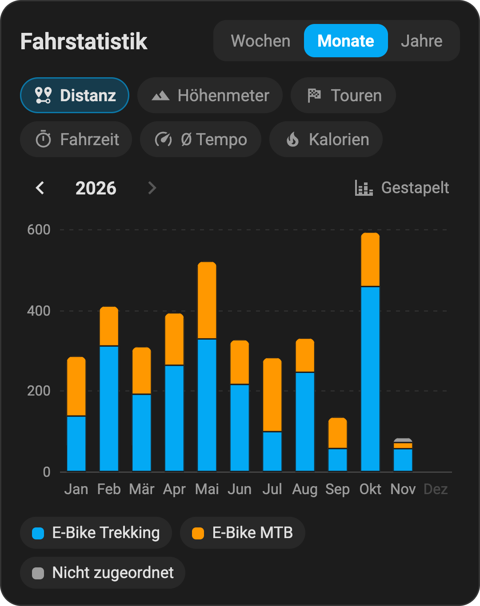
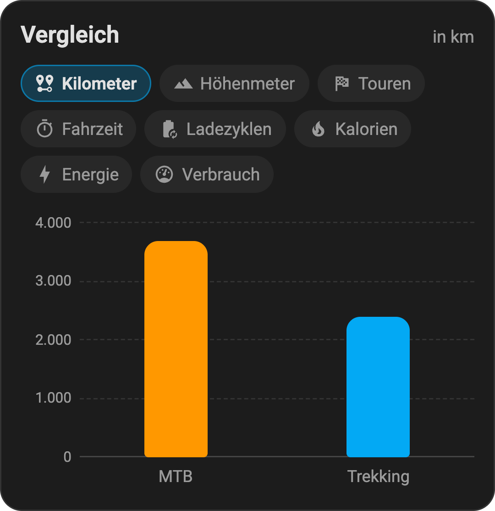
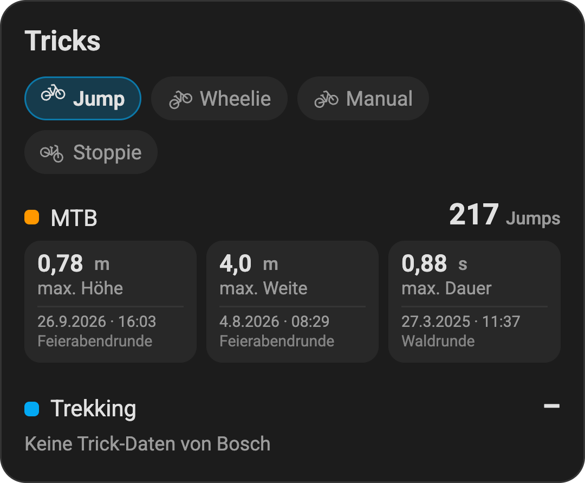
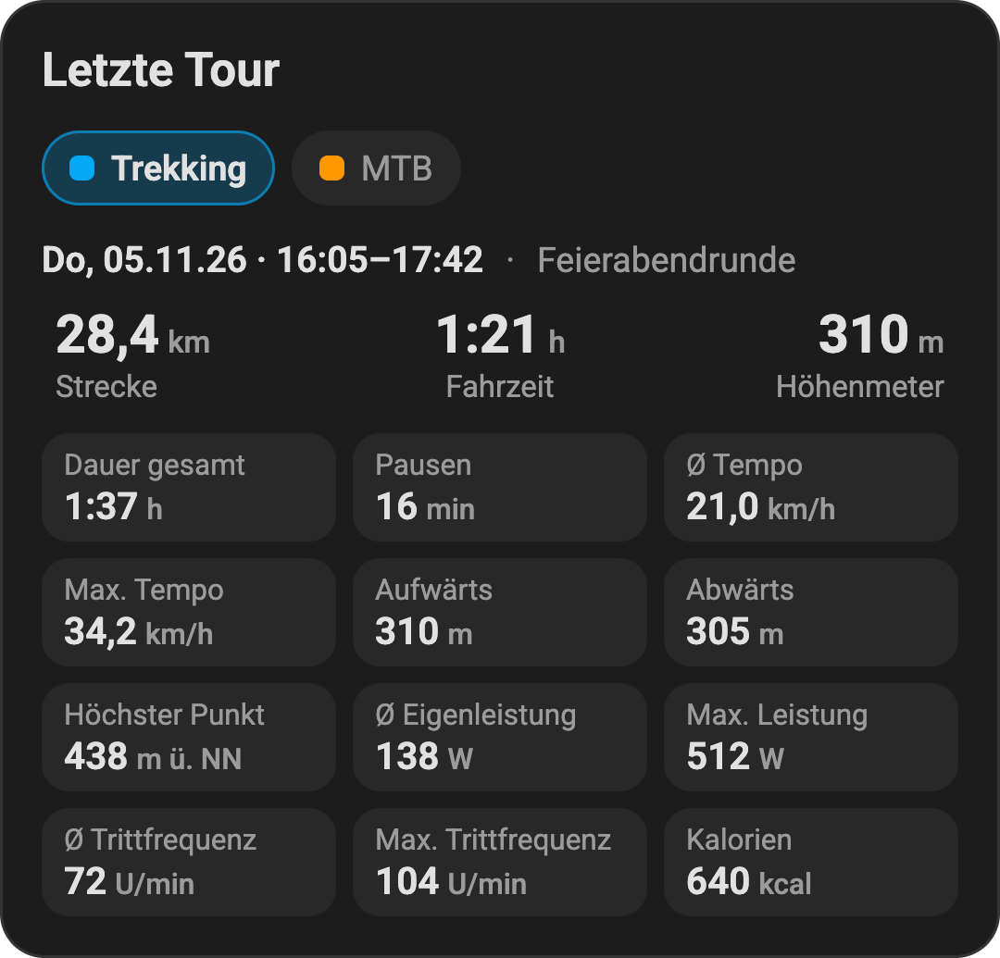
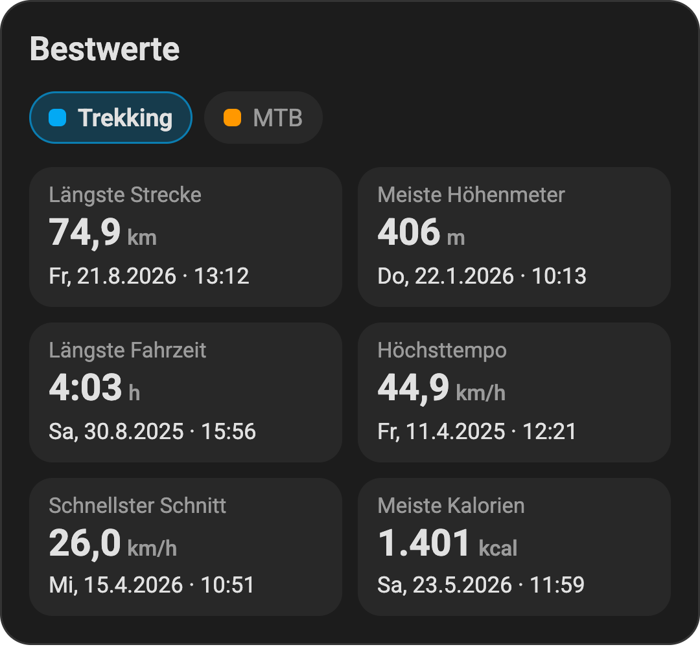
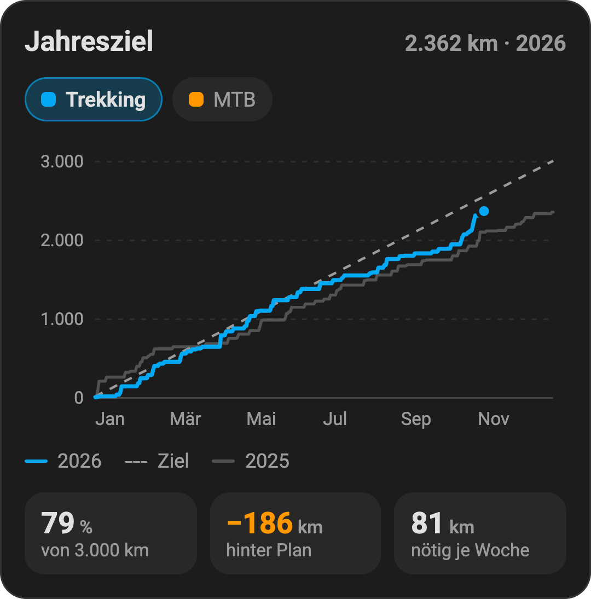

# eBike Cards

Dashboard cards for Home Assistant that display the data of the [ha-bosch-ebike](https://github.com/Xunil99/ha-bosch-ebike) integration.

| Card | Type | Data source |
|---|---|---|
| Ride statistics | `custom:ebike-stats-pro-card` | all rides (websocket) |
| Comparison | `custom:ebike-compare-card` | total sensors per bike |
| Tricks | `custom:ebike-tricks-card` | all rides (websocket) |
| Last ride | `custom:ebike-last-ride-card` | "last ride" sensors |
| Records | `custom:ebike-records-card` | all rides (websocket) |
| Annual goal | `custom:ebike-goal-card` | all rides (websocket) |

All cards live in a single file (`ebike-cards.js`), so HA only needs one resource.

The screenshots under [Configuration](#configuration) come from the demo and show made-up data. The card labels are in German.

## Installation via HACS

1. HACS → ⋮ → **Custom repositories**
   Repository: `https://github.com/JulianHock/ebike-cards`, type: **Dashboard**
2. Search for "eBike Cards" in HACS and **download** it
3. Reload the browser (clear the cache if needed)

HACS adds the resource `/hacsfiles/ebike-cards/ebike-cards.js` itself if your dashboards are managed in UI mode.
In YAML mode, add it yourself:

```yaml
lovelace:
  resources:
    - url: /hacsfiles/ebike-cards/ebike-cards.js
      type: module
```

Updates appear in HA under **Settings → Updates** as soon as a new release is published.

### Switching from a manually copied file

If the cards used to be a single file in `/config/www/`:

1. Under **Settings → Dashboards → ⋮ → Resources**, delete the old resource (`/local/….js`)
2. Remove the old file from `/config/www/`
3. Reload the browser

Your card configurations stay as they are, because the card types are the same.

## Configuration

These options apply to all cards:

| Option | Meaning |
|---|---|
| `title` | Card heading |
| `background` | Custom background (any CSS color, variable or gradient; `url()` is ignored); defaults to the theme's card background |

The cards remember the selected tabs per browser (localStorage, the key includes the title).

The card configuration identifies **bikes** in two ways:

- `prefix`: the entity prefix of the sensors, e.g. `e_bike_trekking` for `sensor.e_bike_trekking_kilometerstand`
- `bike`: alternatively the device name or the bike ID from the integration (Tricks and Records only)

Below the columns of the comparison, long names wrap onto two lines and are only truncated after that.
If there still isn't enough room, `short_name` sets a shorter name for the axis; the tooltip keeps showing `name`:

```yaml
  - { name: Erika E-MTB, short_name: Erika MTB, prefix: e_mtb_erika }
```

### Ride statistics

<table><tr><td width="360">



</td></tr></table>

```yaml
type: custom:ebike-stats-pro-card
title: Fahrstatistik
period: month            # week | month | year
metric: distance         # initial tab
metrics: [distance, elevation, rides, duration, speed, calories]
stacked: true
show_totals: true        # false hides all totals across bikes
legend_values: false     # true shows each bike's total for the period in the legend
height: 220
hide_unassigned: false   # hide rides that aren't assigned to a bike
names:  { "E-Bike Trekking": Trekking }
colors: { "E-Bike Trekking": "#03a9f4" }
order: [Trekking, MTB]
refresh_minutes: 15
```

The bikes come from the integration automatically. `names`, `colors` and `order` refer to a bike's label or ID.

### Comparison

<table><tr><td width="360">



</td></tr></table>

```yaml
type: custom:ebike-compare-card
title: Vergleich
bikes:
  - { name: Trekking, prefix: e_bike_trekking, color: "#03a9f4" }
  - { name: MTB, prefix: e_bike_mtb }
metrics: [odometer, elevation, rides, duration, cycles, calories, energy, efficiency]
layout: vertical         # vertical | horizontal
height: 170
sort: true
show_scale: true
show_leader: false       # trophy for the leader
suffixes:                # optional: different sensor suffixes
  odometer: kilometerstand
```

- `energy` is the energy delivered by the battery in kWh.
- `efficiency` is the consumption in Wh/km; the most economical value comes first.
- A suffix with `*` (e.g. `*_charge_cycles`) adds up all matching sensors of a bike.

### Tricks

<table><tr><td width="360">



</td></tr></table>

```yaml
type: custom:ebike-tricks-card
title: Tricks
bikes:
  - { name: MTB, prefix: e_bike_mtb }
trick: jump              # initial tab
tricks: [jump, wheelie, manual, stoppie]
sort: true
show_leader: false
```

The card adds up wheelies, manuals, stoppies and jumps across all rides. Each record shows the ride in which it was set.

### Last ride

<table><tr><td width="360">



</td></tr></table>

```yaml
type: custom:ebike-last-ride-card
title: Letzte Tour
bikes:
  - { name: Trekking, prefix: e_bike_trekking }
  - { name: MTB, prefix: e_bike_mtb }
bike: Trekking           # initial bike; otherwise the one with the latest ride
show_title: true
fields: [duration, pauses, avg_speed, max_speed, up, down, max_alt,
         avg_power, max_power, avg_cadence, max_cadence, calories, tricks]
```

The card finds the sensors through the device registry (`translation_key`), regardless of language and renames.
If they aren't in the registry, it falls back to the usual German entity IDs.

### Records

<table><tr><td width="360">



</td></tr></table>

```yaml
type: custom:ebike-records-card
title: Bestwerte
bikes:
  - { name: Trekking, prefix: e_bike_trekking }
  - { name: MTB, prefix: e_bike_mtb }
bike: Trekking
records: [distance, up, ride_time, max_speed, avg_speed, calories]
min_avg_km: 5            # minimum distance for "Schnellster Schnitt" (fastest average)
```

### Annual goal

<table><tr><td width="360">



</td></tr></table>

```yaml
type: custom:ebike-goal-card
title: Jahresziel
bikes:
  - { name: Trekking, prefix: e_bike_trekking, goal: 3000 }   # goal: target in km for the current year
  - { name: MTB, prefix: e_bike_mtb, goal: 1500 }
bike: Trekking           # initial bike; otherwise the first one
show_last_year: true     # previous year as a gray line
height: 180
```

Each bike has its own goal. You pick the bike at the top, and the card remembers the selection per browser.
The chart shows the year's cumulative kilometers against the goal line (a steady pace until December 31) and the previous year.
Below it: the share of the goal, how far ahead of or behind plan you are, and the km per week needed for the rest of the year.

## Development

```
src/
  index.js              entry point, imports all cards
  cards/*.js            one file per card
  shared/*.js           shared helpers (formatting, time, websocket, registration)
demo/                   test page with made-up data
build.mjs               esbuild → dist/ebike-cards.js
```

```bash
npm install
npm run build   # build dist/ebike-cards.js
npm run demo    # demo at http://localhost:8000/demo/, rebuilds on changes
npm test        # unit tests
```

### Branches and releases

- `main` holds the published state. Final releases are only made from here; the release workflow rejects other tags.
- `dev` is the working state. CI builds every push and checks the HACS structure.

To make a release:

```bash
git checkout main && git merge dev
npm version minor            # or patch / major: sets the version, commit and tag
git push --follow-tags
```

The tag triggers the release workflow. It builds `ebike-cards.js` and attaches the file to a GitHub release.
HACS then offers the update.

For a test version on `dev`:

```bash
npm version prerelease --preid beta   # e.g. v1.16.0-beta.0
git push --follow-tags
```

This creates a pre-release. You can see it in HACS if you enable "Show beta versions" for the repository.

## License

[MIT](LICENSE)
